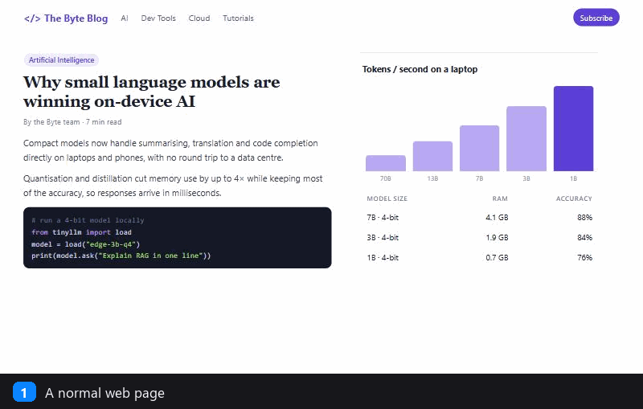
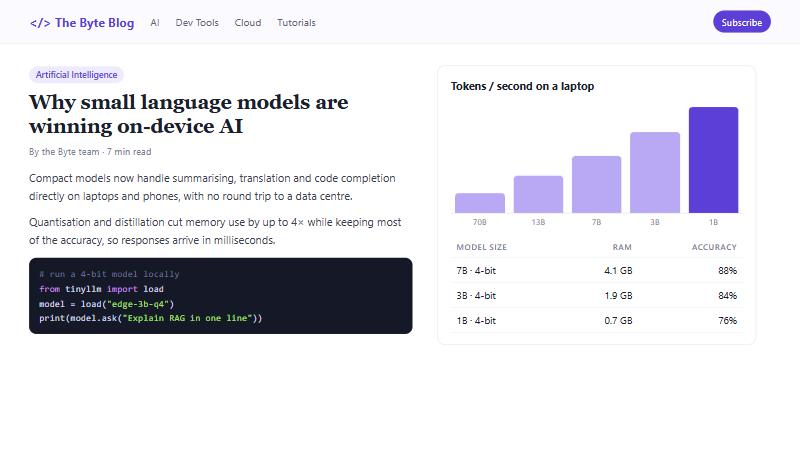
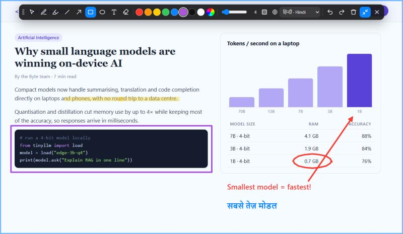
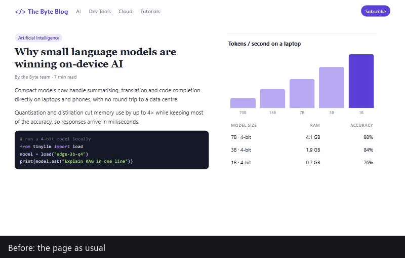
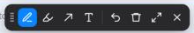
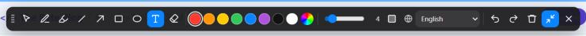
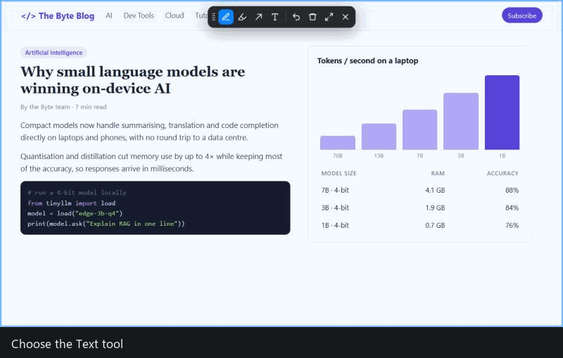
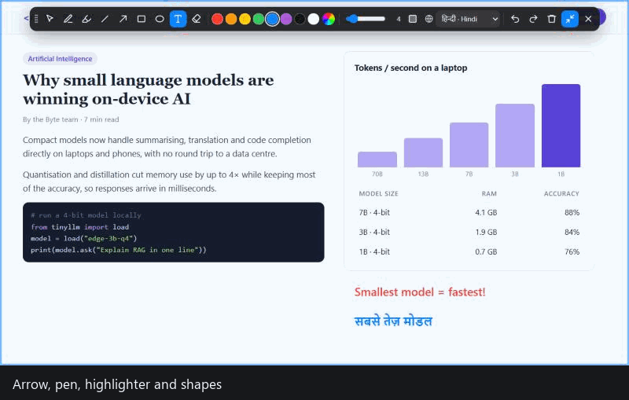
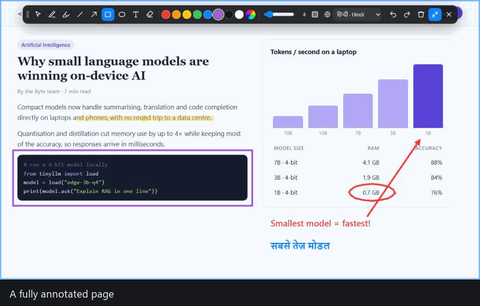
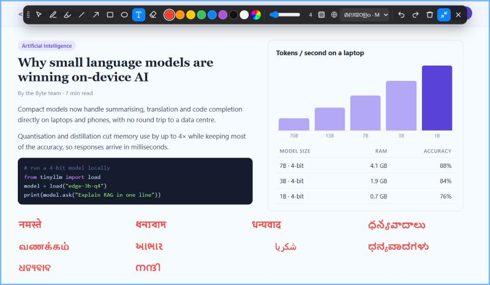

# Web Doodle

**A transparent drawing sheet you can lay over any web page.**

Click the toolbar icon and Web Doodle drops a clear sheet on top of the page you're viewing. You can scribble, highlight, draw lines, arrows and shapes, or type notes, including in **10 Indian languages**. When you're done, clear the sheet or switch it off and every mark disappears. The page itself is never changed.

Works in **Google Chrome, Microsoft Edge, Brave** (and other Chromium browsers) and **Mozilla Firefox**.



---

## Contents

- [Why Web Doodle?](#why-web-doodle)
- [Features](#features)
- [Install](#install)
- [How to use](#how-to-use)
  - [1. Put the sheet on](#1-put-the-sheet-on)
  - [2. The toolbar: minimized and maximized](#2-the-toolbar-minimized-and-maximized)
  - [3. Write text](#3-write-text)
  - [4. Draw, highlight and add shapes](#4-draw-highlight-and-add-shapes)
  - [5. Clear and remove the sheet](#5-clear-and-remove-the-sheet)
- [Typing in Indian languages](#typing-in-indian-languages)
- [Keyboard shortcuts](#keyboard-shortcuts)
- [Privacy](#privacy)
- [How it works](#how-it-works)
- [Limitations](#limitations)
- [Packaging for the browser stores](#packaging-for-the-browser-stores)
- [Project files](#project-files)

---

## Why Web Doodle?

Sometimes you just want to **point at something** on a web page: circle a number during a screen-share, underline a sentence while teaching, sketch an idea on a design review, or mark up a page before taking a screenshot. Web Doodle gives you a whiteboard pen for the web. It's temporary by design: nothing is saved, nothing is sent anywhere, and turning it off leaves the page exactly as it was.

| Before | With Web Doodle |
|---|---|
|  |  |

## Features

- 🪟 **Transparent sheet:** a clear layer over the page with a soft blue border so you can tell it's on.
- 🧰 **Compact toolbar:** starts **minimized** with just the essentials; one click **maximizes** it to show everything.
- ✏️ **Pen:** smooth freehand drawing.
- 🖍️ **Highlighter:** wide, see-through marker that won't hide the text underneath.
- ➖ **Line** and ➡️ **Arrow:** hold <kbd>Shift</kbd> to snap to 45° angles.
- ⬜ **Rectangle** and ⭕ **Ellipse:** hold <kbd>Shift</kbd> for a perfect square or circle, with optional translucent fill.
- 🔤 **Text:** click anywhere and type; multi-line supported.
- 🇮🇳 **10 Indian languages:** Hindi, Bengali, Marathi, Telugu, Tamil, Gujarati, Urdu, Kannada, Odia and Malayalam (plus Punjabi), typed **phonetically with an ordinary English keyboard**.
- 🧽 **Eraser:** removes any drawing you click or drag over.
- 🎨 8 preset colours plus a custom colour picker; adjustable stroke width and text size.
- ↩️ **Undo / Redo**, 🗑️ **Clear all**, ❌ **Close**.
- 🖱️ **Interact mode:** keep your drawings visible while clicking links and scrolling the page normally.
- 📜 Drawings are **pinned to the page** and scroll with it.
- 🔒 **Private:** no network requests, no tracking. Only your language choice is remembered.

## Install

The extension isn't on the browser stores yet, so you load it from this folder. It takes about a minute.

### Google Chrome · Microsoft Edge · Brave

1. Download or clone this repository.
2. Open the extensions page:
   - Chrome: `chrome://extensions`
   - Edge: `edge://extensions`
   - Brave: `brave://extensions`
3. Turn on **Developer mode** (top-right in Chrome/Brave, left sidebar in Edge).
4. Click **Load unpacked** and select the `web-doodle` folder (the one that contains `manifest.json`).
5. Click the puzzle-piece icon in the toolbar and **pin** Web Doodle so the icon is always visible.

### Mozilla Firefox (version 121 or newer)

1. Open `about:debugging#/runtime/this-firefox`.
2. Click **Load Temporary Add-on…**
3. Select the `manifest.json` file inside the `web-doodle` folder.

> **Note:** Firefox removes temporary add-ons when it restarts. For a permanent install the extension has to be signed through [addons.mozilla.org](https://addons.mozilla.org/developers/) (see [Packaging](#packaging-for-the-browser-stores)).

## How to use

### 1. Put the sheet on

Click the **Web Doodle** icon in the browser toolbar, or press <kbd>Alt</kbd>+<kbd>Shift</kbd>+<kbd>D</kbd>. A transparent sheet with a thin blue border covers the page, and a small toolbar appears at the top. The icon shows an **ON** badge while the sheet is active.



### 2. The toolbar: minimized and maximized

The toolbar opens **minimized** so it stays out of your way. It shows only the tools you'll use most:



**Pen · Highlighter · Arrow · Text | Undo · Clear · Maximize · Close**

Click **Maximize** (⤢, or press <kbd>M</kbd>) to show the full toolbar. Click it again (⤡) to shrink back.



From left to right: drag handle · interact with page · pen · highlighter · line · arrow · rectangle · ellipse · text · eraser · colours · custom colour · width/size slider · fill toggle · text language · undo · redo · clear · minimize · close.

> **Tip:** drag the toolbar by its dotted handle (⋮⋮) on the left if it covers something you want to mark up.

### 3. Write text

Choose **Text** (<kbd>T</kbd>), click where you want the note, and type.

- <kbd>Enter</kbd> finishes the note; <kbd>Shift</kbd>+<kbd>Enter</kbd> starts a new line.
- <kbd>Esc</kbd> cancels the note you're typing.
- The text uses the selected colour, and the slider sets its size.
- To write in an Indian language, maximize the toolbar and pick it from the 🌐 drop-down (see [below](#typing-in-indian-languages)).



### 4. Draw, highlight and add shapes

| Tool | How |
|---|---|
| **Pen** (<kbd>P</kbd>) | Press and drag to draw freehand. |
| **Highlighter** (<kbd>H</kbd>) | Drag across text. It's see-through, so the words stay readable. |
| **Line** (<kbd>L</kbd>) / **Arrow** (<kbd>A</kbd>) | Drag from start to end. Hold <kbd>Shift</kbd> to snap to horizontal, vertical or 45°. |
| **Rectangle** (<kbd>R</kbd>) / **Ellipse** (<kbd>O</kbd>) | Drag out the shape. Hold <kbd>Shift</kbd> for a square or circle. Press <kbd>F</kbd> (or the fill button) for a translucent fill. |
| **Eraser** (<kbd>E</kbd>) | Click or drag over any drawing to remove it. |
| **Interact** (<kbd>V</kbd>) | Leaves your drawings on screen but lets you click and scroll the page underneath. |



### 5. Clear and remove the sheet

- **Clear** (🗑️) wipes every drawing but keeps the sheet on, ready for more. You can undo it with <kbd>Ctrl</kbd>+<kbd>Z</kbd>.
- **Close** (❌), <kbd>Esc</kbd>, the toolbar icon or <kbd>Alt</kbd>+<kbd>Shift</kbd>+<kbd>D</kbd> removes the sheet **and everything on it**. Reloading or leaving the page does the same.



## Typing in Indian languages

Maximize the toolbar, open the 🌐 language list and pick a language. Then **type the word the way it sounds, in English letters**. A small preview appears under your text, and the word converts as soon as you press <kbd>Space</kbd>, <kbd>Enter</kbd> or a punctuation key.



| Language | Type | You get |
|---|---|---|
| Hindi (हिन्दी) | `namaste` | नमस्ते |
| Bengali (বাংলা) | `dhanyabaad` | ধন্যবাদ |
| Marathi (मराठी) | `dhanyavaad` | धन्यवाद |
| Telugu (తెలుగు) | `dhanyavaadaalu` | ధన్యవాదాలు |
| Tamil (தமிழ்) | `vaNakkam` | வணக்கம் |
| Gujarati (ગુજરાતી) | `aabhaar` | આભાર |
| Urdu (اردو) | `shukriyaa` | شکریا |
| Kannada (ಕನ್ನಡ) | `dhanyavaadagaLu` | ಧನ್ಯವಾದಗಳು |
| Odia (ଓଡ଼ିଆ) | `dhanyabaad` | ଧନ୍ୟବାଦ |
| Malayalam (മലയാളം) | `nandi` | നന്ദി |
| Punjabi (ਪੰਜਾਬੀ) *(bonus)* | `panjaabee` | ਪੰਜਾਬੀ |

### Quick spelling guide

The scheme is similar to the popular *ITRANS* style:

| You type | Meaning | Example (Hindi) |
|---|---|---|
| `a` `aa` / `A` | short / long a | क / का |
| `i` `ii` / `ee` | short / long i | कि / की |
| `u` `uu` / `oo` | short / long u | कु / कू |
| `e` `ai` `o` `au` | other vowels | के कै को कौ |
| `T` `Th` `D` `Dh` `N` | retroflex letters (capitals) | ट ठ ड ढ ण |
| `t` `th` `d` `dh` `n` | dental letters | त थ द ध न |
| `sh` / `Sh` | श / ष | शाम / षट |
| `kSh` or `x`, `gy` | conjuncts | क्ष, ज्ञ |
| `M` · `H` · `~` | anusvara ं · visarga ः · chandrabindu ँ | हं · दुःख · माँ |
| `L` | ळ / ള / ಳ | — |
| `z`, `f`, `q` | nukta letters | ज़, फ़, क़ |

Notes for specific languages:

- **Tamil and Malayalam:** a consonant at the end of a word gets a pulli/chandrakkala automatically (`vaNakkam` → வணக்கம்). Use `zh` for ழ/ഴ and `rr` for ற/റ. In Tamil, aspirated and voiced letters fall back to the nearest Tamil letter (`kh`, `g` → க).
- **Telugu, Kannada, Malayalam, Tamil:** `e`/`o` are short (ె, ొ) and `E`/`O` are long (ే, ో).
- **Urdu:** phonetic Roman-Urdu (`kh` خ, `gh` غ, `q` ق, `R` ڑ, `N` ں). Short vowels inside a word are left out, as in normal Urdu writing. The result is a close approximation, so check longer words.
- **Already have an Indian keyboard or IME** (Windows, macOS, Google Input Tools…)? Choose **English** in the list and type with your own keyboard. Web Doodle accepts any script.

Your language choice is remembered for next time.

## Keyboard shortcuts

These work while the sheet is on (and you're not typing in a text box):

| Key | Action |
|---|---|
| <kbd>Alt</kbd>+<kbd>Shift</kbd>+<kbd>D</kbd> | Toggle the sheet on/off (works from anywhere) |
| <kbd>V</kbd> | Interact with page |
| <kbd>P</kbd> / <kbd>H</kbd> | Pen / Highlighter |
| <kbd>L</kbd> / <kbd>A</kbd> | Line / Arrow |
| <kbd>R</kbd> / <kbd>O</kbd> | Rectangle / Ellipse |
| <kbd>T</kbd> | Text |
| <kbd>E</kbd> | Eraser |
| <kbd>F</kbd> | Toggle shape fill |
| <kbd>M</kbd> | Maximize / minimize the toolbar |
| <kbd>Ctrl</kbd>+<kbd>Z</kbd> | Undo |
| <kbd>Ctrl</kbd>+<kbd>Y</kbd> or <kbd>Ctrl</kbd>+<kbd>Shift</kbd>+<kbd>Z</kbd> | Redo |
| <kbd>Esc</kbd> | Cancel the text you're typing; otherwise close the sheet |
| <kbd>Shift</kbd> while dragging | Snap angles / perfect squares and circles |

To change the toggle shortcut: `chrome://extensions/shortcuts` (Chrome/Brave), `edge://extensions/shortcuts` (Edge), or **Add-ons → ⚙ → Manage Extension Shortcuts** (Firefox).

## Privacy

- Web Doodle runs **only on the tab where you click it**, and only when you click it. It uses the browser's `activeTab` permission, so it can't read other tabs or run in the background.
- It makes **no network requests** and collects no data.
- Your drawings exist only in the page's memory and are thrown away when you close the sheet, reload or navigate away.
- The only thing stored is your chosen text language (`storage` permission), kept locally in your browser.

## How it works

- **`background.js`** listens for the toolbar icon or shortcut and injects the drawing scripts into the current tab. Running the scripts again toggles the sheet off. The **ON** badge is kept in sync.
- **`content.js`** creates the sheet: a full-window `<canvas>` plus the toolbar, inside a closed **Shadow DOM** so the website's styles can't affect it (and it can't affect the website). Every drawing is stored as a small vector object in page coordinates, so it can be redrawn crisply when you scroll, resize or zoom, and so undo, redo and the eraser are simple.
- **`translit.js`** converts phonetic English into each script. The nine Brahmi-derived scripts share a parallel Unicode layout, so one rule set (with small per-language adjustments) covers them all. Urdu has its own Roman-Urdu table.
- One `manifest.json` serves every browser: Chromium uses `background.service_worker`; Firefox uses `background.scripts` and `browser_specific_settings`.

## Limitations

- Browsers don't let extensions run on their own pages: `chrome://`, `edge://`, `about:` pages, the new-tab page, or the extension stores. The icon briefly shows **✕** there.
- Drawings follow the main page's scrolling. On sites that scroll an inner panel (some web apps and PDF viewers), drawings stay fixed to the window instead.
- Some sites with strict security settings may block the injected script. If the sheet doesn't appear, try another page.
- Phonetic typing is a convenience, not a full input method. For long or unusual words, a native keyboard or IME gives the most accurate spelling.

## Packaging for the browser stores

Create a zip of just the extension files (without `docs/`):

```powershell
Compress-Archive -Path manifest.json,background.js,content.js,translit.js,icons -DestinationPath web-doodle.zip -Force
```

- **Chrome Web Store / Edge Add-ons:** upload `web-doodle.zip` in the developer dashboard. Brave installs extensions from the Chrome Web Store.
- **Firefox Add-ons (AMO):** upload the same zip. Before submitting, change the add-on ID `web-doodle@example.com` in `manifest.json` to one you own.

## Project files

```
web-doodle/
├── manifest.json      Extension manifest (Chrome, Edge, Brave, Firefox)
├── background.js      Toggles the sheet and shows the ON badge
├── content.js         The transparent sheet, toolbar and drawing tools
├── translit.js        Phonetic typing for Indian languages
├── icons/             Toolbar and store icons (16, 32, 48, 128 px)
└── docs/              Screenshots and GIFs used in this README
```

## License

Released under the [MIT License](LICENSE). You can use, copy, change and share it freely, including in commercial projects, as long as you keep the copyright and license notice.
